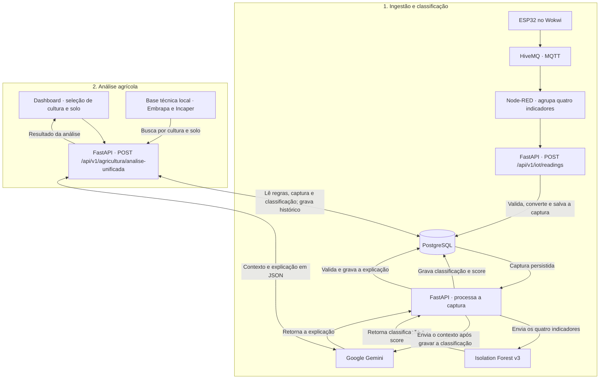

# 🌱 AgroConnect AI
## FIAP · Global Solution 2026/2 · Disruptive Architectures: IoT, IoB & Generative IA

---

## 👥 Integrantes

#### NOME: Rafael Pascotte Mercadante

RM564928 - 2TDSPI

#### NOME: Rafael de Freitas Moraes

RM563210 - 2TDSPI

#### NOME: Carolina Nascimento Gonçalves

RM564786 - 2TDSPI

#### NOME: Emanuelly Ventura do Nascimento

RM562339 - 2TDSPI

#### NOME: Julia Sayuri Kina

RM564555 - 2TDSPI

---

## 📌 Problema e público

O projeto aborda o tema 07 da CitizenTech, **Pequenos produtores sem informação para decidir**. O AgroConnect AI ajuda pequenos produtores rurais a interpretar as condições de uma estufa, identificar leituras que merecem atenção e consultar critérios de compatibilidade entre uma cultura e um tipo de solo. O painel reúne as leituras, a classificação estatística, os critérios agrícolas e as respectivas fontes.

Por exemplo, na análise de **feijão em solo argiloso**, o painel exibe **Desconhecido** porque a classe do solo, por si só, é insuficiente para concluir a compatibilidade. A regra indica o que verificar no terreno, como compactação e risco de encharcamento, e apresenta a fonte do critério.

O AgroConnect se alinha ao **ODS 2 — Fome Zero e Agricultura Sustentável** ao organizar informações e referências que ajudam pequenos produtores a avaliar condições de cultivo.

### Arquitetura



Na ingestão, o FastAPI salva a captura antes de executar o detector. Na análise agrícola, a API seleciona a captura válida mais recente dentro da janela configurada e consulta a classificação já persistida. A compatibilidade é determinada pela matriz de **25 combinações de culturas e solos**. A decisão é gravada antes da geração, e o Gemini acrescenta a explicação ao mesmo registro de histórico.

---

## 📊 Dados e preparação

| Fonte | Preparação e uso |
| --- | --- |
| **Sensores no Wokwi** | O Node-RED agrupa temperatura do ar do BMP180, temperatura e umidade relativa do DHT22 e luminosidade do LDR. O FastAPI valida os valores e as unidades. Converte a temperatura do DHT22 em um índice demonstrativo de umidade do solo e mantém a umidade relativa do ar como uma leitura separada. |
| **Conjunto de treinamento e avaliação** | A [fixture sintética](tests/fixtures/isolation_forest_rotulado.json) fornece 120 exemplos de treino e 64 exemplos rotulados de avaliação. Os indicadores são ordenados de forma canônica e padronizados com o scaler ajustado no treino. |
| **Fontes agrícolas** | Os critérios e as referências se baseiam em publicações da Embrapa e do Incaper. Na análise unificada, o recuperador local filtra trechos por cultura, solo e assunto. Os resultados mantêm título, instituição, endereço e curadoria. |

Veja os guias de [telemetria](documentacao/telemetria_iot.md), [modelo](documentacao/aprendizado_maquina.md) e [matriz de compatibilidade](documentacao/compatibilidade_agricola.md).

---

## 🛠️ Escolhas técnicas

| Tecnologia | Por que foi escolhida |
| --- | --- |
| **Isolation Forest v3 com scikit-learn** | Detecta padrões atípicos nas quatro leituras usando treinamento não supervisionado. A classificação e o score ficam no PostgreSQL e podem ser reutilizados em novas análises agrícolas. |
| **RAG básico com documentos locais** | Os filtros por cultura, classe de solo e assunto são adequados ao tamanho da base e permitem rastrear quais trechos fundamentam a explicação. |
| **Google Gemini via API** | Organiza a regra agrícola, a telemetria e as referências em uma explicação em português. A API solicita JSON estruturado e valida os campos e as referências antes de exibir o resultado. A validação local usou `gemini-3.5-flash-lite`. |
| **FastAPI, PostgreSQL e Docker Compose** | O FastAPI centraliza a ingestão e a consulta. O PostgreSQL mantém capturas, regras e histórico. O Docker Compose provisiona o banco local. As migrations usam SQL e blocos PL/pgSQL para verificar e criar restrições de estado no banco. |

---

## 🚀 Executar localmente

**Requisitos:** Python x64 3.12 ou 3.13, Docker com contêineres Linux e `uv` 0.13.7. Para transmitir novas capturas, prepare também o Wokwi, o HiveMQ e o Node-RED conforme o [guia de telemetria](documentacao/telemetria_iot.md).

### 1. Instalar as dependências

Na raiz do repositório, execute no PowerShell. Ajuste `$pythonX64` se o executável de 64 bits estiver instalado em outro caminho.

```powershell
$pythonX64 = "$env:LOCALAPPDATA\Programs\Python\Python313\python.exe"
& $pythonX64 -c "import struct; assert struct.calcsize('P') == 8, 'Use Python de 64 bits'"
if ($LASTEXITCODE -ne 0) { throw 'Não foi possível validar o Python de 64 bits.' }
& $pythonX64 -m venv .venv-313-x64
.\.venv-313-x64\Scripts\Activate.ps1
python -m pip install uv==0.13.7
$env:UV_PROJECT_ENVIRONMENT = ".venv-313-x64"
python -m uv sync --locked --python .\.venv-313-x64\Scripts\python.exe
```

Se você já instalou as dependências na `.venv-313-x64`, basta ativá-la em cada novo terminal. Para usar Python 3.12, aponte `$pythonX64` para o executável dessa versão e use o nome correspondente nas referências à pasta do ambiente.

### 2. Configurar o banco e o Gemini

Na primeira configuração, crie o `.env` local a partir de [`.env.example`](.env.example) e preencha os valores do PostgreSQL, a URL `TELEMETRY_DATABASE_URL` e a chave `GEMINI_API_KEY`. Para reproduzir o modelo usado na validação local, defina `GEMINI_MODEL=gemini-3.5-flash-lite`.

```powershell
docker compose up -d postgres
```

Aplique as migrations **001 a 008** na ordem indicada no [guia do PostgreSQL](documentacao/postgresql_local.md).

### 3. Gerar o modelo e iniciar a API

```powershell
python scripts/treinar_modelo.py
python -m uvicorn app.principal:app --reload
```

Execute o treino quando precisar gerar ou atualizar o artefato. No uso diário, com o banco já migrado e o artefato pronto, ative o ambiente de 64 bits, suba o PostgreSQL e inicie o Uvicorn. Depois que aparecer `Application startup complete`, estes endereços locais ficam disponíveis:

- [Dashboard do AgroConnect](http://127.0.0.1:8000/dashboard)
- [Swagger UI](http://127.0.0.1:8000/docs)
- [Prontidão do PostgreSQL](http://127.0.0.1:8000/health/ready)

No dashboard, confira **Última captura**, selecione uma cultura e um solo e clique em **Analisar combinação**. O resultado aparece ao lado dos critérios e das referências. A tabela de histórico exibe as análises persistidas.

### 4. Importar o fluxo Node-RED

Veja a seção [ESP32 da estufa no Wokwi](#esp32-da-estufa-no-wokwi).

No Node-RED, abra **Menu → Importar** e selecione o [fluxo de ingestão do AgroConnect](iot/node_red/fluxo_agroconnect.json). Abra a configuração compartilhada **HiveMQ Cloud**, troque o host de exemplo pelo endereço do seu cluster e informe usuário e senha no próprio Node-RED. O fluxo usa MQTT com TLS na porta `8883`.

No nó HTTP, confira a URL `http://127.0.0.1:8000/api/v1/iot/readings`. Quando a API estiver em outro host ou contêiner, informe um endereço alcançável pelo processo do Node-RED. Clique em **Deploy**, inicie o Wokwi e acompanhe a resposta da API no nó de depuração. O [guia de telemetria](documentacao/telemetria_iot.md#importar-o-fluxo-node-red) detalha a configuração e os tópicos.

---

### ESP32 da estufa no Wokwi

O ESP32 lê o DHT22, o BMP180 e o LDR. A cada 5 segundos, publica as leituras no HiveMQ Cloud via MQTT. O Node-RED reúne quatro tópicos e envia uma captura para `POST /api/v1/iot/readings`. Consulte o [guia de telemetria](documentacao/telemetria_iot.md) para importar o fluxo e conferir a captura na API.

#### Ligações do circuito

| Componente | Sinal no ESP32 |
| --- | --- |
| DHT22 | DATA no GPIO 4 |
| LDR | Saída analógica no GPIO 34 |
| BMP180 e OLED SSD1306 | SDA no GPIO 21 e SCL no GPIO 22 (barramento I²C compartilhado) |
| LED verde | GPIO 25 |
| LED vermelho | GPIO 26 |

O OLED é configurado como 128 × 64, no endereço I²C `0x3C`. Ele mostra o estado do sistema, Wi-Fi, MQTT, horário (UTC−3 via NTP) e o último erro. O LED verde indica operação online e o vermelho indica falha.

#### Executar e conferir

1. Abra o projeto original da estufa no Wokwi. O [sketch](iot/wokwi/sketch.ino) e a [lista de bibliotecas](iot/wokwi/libraries.txt) estão aqui. O circuito (`diagram.json`), incluindo o componente usado para simular o BMP180, deve vir do projeto original. Para instalar as dependências, use o Library Manager do Wokwi ou copie o `libraries.txt` para o projeto. Veja a [documentação de bibliotecas do Wokwi](https://docs.wokwi.com/guides/libraries).
2. Na sua cópia do sketch, preencha `MQTT_SERVER`, `MQTT_USER` e `MQTT_PASSWORD` com os dados do broker usado pelo Node-RED. A porta é `8883`. A rede [Wokwi-GUEST](https://docs.wokwi.com/guides/esp32-wifi) usa senha vazia. Mantenha as credenciais fora do Git e de projetos compartilhados.
3. No Node-RED, use as instruções de [importação e configuração](documentacao/telemetria_iot.md#importar-o-fluxo-node-red). Inicie a simulação e abra o monitor serial a 115200 baud. Confira as mensagens de conexão ao Wi-Fi e ao MQTT e, em seguida, os blocos `Dados enviados:`.
4. Para validar a integração, confira a resposta HTTP na aba de depuração do Node-RED e procure a nova captura em **Última captura** no dashboard.

O sketch de demonstração usa TLS com `setInsecure()`, que desativa a validação da identidade do broker. Para uso em produção, configure a CA do broker no cliente e habilite a validação do certificado.

#### Mensagens MQTT

| Tópico | Payload | Uso no fluxo de ingestão |
| --- | --- | --- |
| `estufa/dht22/temperatura` | Temperatura em °C | Fonte do índice demonstrativo de umidade do solo, calculado pela API |
| `estufa/dht22/umidade` | Umidade relativa em % | Umidade do ar |
| `estufa/ldr/luminosidade` | Leitura ADC bruta | Luminosidade |
| `estufa/bmp180/temperatura` | Temperatura em °C | Temperatura do ar |
| `estufa/bmp180/pressao` | Pressão em hPa | Fora do agrupamento |
| `estufa/bmp180/altitude` | Altitude estimada em metros | Fora do agrupamento |
| `estufa/status` | `online` ou `erro` | Fora do agrupamento |
| `estufa/erro` | Descrição do erro ou `nenhum` | Fora do agrupamento |

Os valores são publicados como texto numérico em tópicos individuais. O sketch tenta reconectar quando perde o Wi-Fi ou o MQTT. A publicação de status e erro exige conexão com o broker. O índice de umidade do solo é calculado no backend a partir da temperatura do DHT22 e é usado apenas na demonstração.

### Onde acompanhar o fluxo no código

- **Captura da estufa.** O `loop()` do ESP32 chama `lerSensoresEEnviar()` a cada cinco segundos para publicar os sensores em tópicos MQTT. O Node-RED reúne as quatro mensagens necessárias em uma captura HTTP. O FastAPI valida e persiste essa captura para que o dashboard e o modelo usem os mesmos dados. [Sketch](iot/wokwi/sketch.ino) · [Telemetria](documentacao/telemetria_iot.md)
- **Classificação e explicação.** A rota de ingestão lê a captura salva, chama `DetectorAnomalias.predizer()` e grava o score e a classificação. O cliente Gemini recebe esse resultado para gerar o texto exibido no painel. [Modelo](documentacao/aprendizado_maquina.md) · [Gemini](documentacao/integracao_gemini.md)
- **Análise agrícola.** O formulário envia os IDs de cultura e solo. A API consulta a regra cadastrada, recupera a captura recente e as referências técnicas e grava a análise para consulta no histórico. [Análise agrícola](documentacao/analise_agricola.md)

## 🧪 Avaliação e evidências

O [registro de validação](documentacao/validacao.md) reúne consultas reproduzíveis, resultados locais e métricas. Na verificação de 17/11/2026:

- **299 testes** passaram com PostgreSQL, incluindo ingestão, persistência e histórico quando o Gemini responde ou expira.
- **53 capturas Wokwi** foram classificadas pelo Isolation Forest, com 36 observações atípicas e 9 explicações Gemini gravadas para essas capturas.
- A avaliação do modelo sobre **64 exemplos sintéticos** obteve precisão, revocação e F1 de **1,00**. Essas métricas descrevem o conjunto de avaliação. Os registros Wokwi documentam a execução do fluxo integrado.

Use um banco de testes dedicado configurado em `TEST_TELEMETRY_DATABASE_URL`, conforme o [guia PostgreSQL](documentacao/postgresql_local.md), e execute:

```powershell
python scripts/avaliar_modelo.py
python -m pytest -q
```

---

## ⚠️ Interpretação e uso responsável

- O **score do Isolation Forest** indica atipicidade em relação ao conjunto de treino. Serve para priorizar leituras que merecem conferência.
- O **índice demonstrativo de umidade do solo** é calculado com a temperatura do DHT22. Para decisões sobre a umidade real, é necessária uma medição no solo.
- A **explicação Gemini** serve como apoio informativo e cita as referências recuperadas. A classificação vem do Isolation Forest, e o resultado de compatibilidade vem das regras cadastradas. As condições do terreno, como drenagem e compactação, devem ser confirmadas antes de uma decisão de cultivo.
- A chave Gemini e as credenciais do banco ficam no `.env` local. O contexto enviado ao Gemini reúne dados técnicos da captura e da análise agrícola.

---

## 🤖 Uso de IA no desenvolvimento

O Codex auxiliou na revisão do README e dos guias, na organização das evidências e no apoio ao desenvolvimento e à verificação do projeto. O Google Gemini é o modelo generativo utilizado pela aplicação.


## Vídeo da demonstração

[AgroConnect AI — demonstração no YouTube](https://youtu.be/05tSDLXzBJY)

## 📚 Guias da entrega

- [Arquitetura](documentacao/arquitetura.md)
- [Análise agrícola](documentacao/analise_agricola.md)
- [Evidências de validação](documentacao/validacao.md)
- [Integração Gemini](documentacao/integracao_gemini.md)
- [Dashboard](documentacao/dashboard.md)
- [Contrato HTTP](documentacao/contrato_http.md)
- [Telemetria IoT e Node-RED](documentacao/telemetria_iot.md)
- [Aprendizado de máquina](documentacao/aprendizado_maquina.md)
- [Matriz de compatibilidade](documentacao/compatibilidade_agricola.md)
- [Recomendações por captura](documentacao/recomendacoes_wokwi.md)
- [PostgreSQL local](documentacao/postgresql_local.md)
